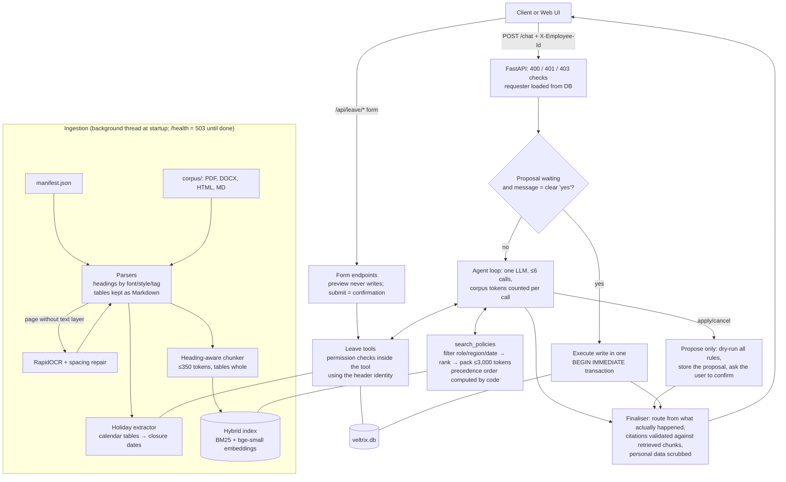

# Veltrix PeopleOps Assistant

An HR assistant for the fictional Veltrix Systems. It answers employee questions from 30 HR documents with citations, decides which documents apply to the person asking (role, region, date, precedence), and reads and changes leave data through five permission-checked tools. Write actions require explicit confirmation.

It is a **single-agent** design. One LLM runs a bounded tool loop, and code enforces everything that has a correct answer: identity, document eligibility and precedence order, the corpus token budget, permissions, working days, write confirmation, routes and personal-data masking.

## Quick start

```bash
cp .env.example .env          # then set LLM_PROVIDER and its API key (see Configuration)
# put the data in ./data:  data/corpus/  data/manifest.json  data/veltrix.db
docker compose up --build
curl localhost:8000/health    # 503 while ingesting, then {"status": "ok"} (about 15-40 s)
curl -X POST localhost:8000/chat -H "X-Employee-Id: E2004" -H "Content-Type: application/json" \
     -d '{"session_id": "demo", "message": "How many sick days do I get?"}'
```

Then open **http://localhost:8000** for the web UI.

## Web UI

The service serves a small web app at `/`. It is plain HTML, CSS and JavaScript with no build step and no external requests, and it supports light and dark mode and phone widths. Sign in with an employee ID, for example `E2004` (employee), `E2002` (manager) or `E1002` (HR). Login is out of scope, so the ID is sent as `X-Employee-Id` exactly as the API expects.

| Page | What it does |
|---|---|
| **Ask HR** | Chat over `POST /chat`. Each answer shows its route, sources (document title and section) and the tools used. When the assistant proposes a leave request or cancellation, **Confirm** / **Not now** buttons send the confirmation turn. |
| **Apply for leave** | An application form: leave type (with current balances), first and last day, and the remaining public holidays for your office. A live summary shows working days, holidays not counted and the balance before and after, or the exact rule that blocks the request. **Submit request** is the explicit confirmation. |
| **My leave** | Balance cards and all requests with status. Future pending or approved requests can be cancelled after a confirmation dialog. |
| **Team** | Managers only: leave of direct reports in a date range. |

The form and leave pages use extra JSON endpoints under `/api/` ([app/web/routes.py](app/web/routes.py)). They call the same tool functions as the agent, so the same permission checks and leave rules apply, and they never involve the LLM. `/api/leave/preview` never writes. Writes happen only on `/api/leave/apply` and `/api/leave/cancel`, each in one transaction. These endpoints are additions; the `/chat` and `/health` contract is unchanged.

Without Docker (Python 3.10+):

```bash
python -m venv .venv && .venv/bin/pip install -r requirements.txt   # Windows: .venv\Scripts\pip
make run          # or: uvicorn app.main:get_app --factory --port 8000
make test         # or: python -m pytest
python scripts/smoke_test.py   # sample queries against a running service (needs an API key)
```

The first local run downloads the embedding model (about 65 MB) into `./.cache/models`. If your network blocks Hugging Face's Xet CDN, set `HF_HUB_DISABLE_XET=1`. The Docker image includes the embedding model, the tokenizer and the OCR models, so the container only talks to the LLM API.

## Configuration

Every variable is listed in [.env.example](.env.example). The required ones are `CORPUS_DIR`, `MANIFEST_PATH`, `DB_PATH`, `APP_TODAY` (empty means the system date), `LLM_PROVIDER` and the API key of the selected provider:

| `LLM_PROVIDER` | Key | Model variable (default) |
|---|---|---|
| `anthropic` (default) | `ANTHROPIC_API_KEY` | `ANTHROPIC_MODEL` (`claude-opus-5-5`) |
| `openai` | `OPENAI_API_KEY` | `OPENAI_MODEL` (`gpt-4.1`); optional `OPENAI_BASE_URL` |
| `groq` | `GROQ_API_KEY` | `GROQ_MODEL` (`openai/gpt-oss-120b`) |

Optional: `LLM_EFFORT` (Anthropic only, default `low`), `LLM_FALLBACKS` (Anthropic only), `LOG_LEVEL` and `LOG_FILE`. The OpenAI and Groq providers share one implementation ([app/orchestration/llm.py](app/orchestration/llm.py), `OpenAICompatibleProvider`) that translates the agent's requests to Chat Completions and runs at temperature 0. OpenAI gets the final answer as a strict JSON schema; Groq does not accept a schema together with tools, so there the system prompt asks for the JSON object and the agent extracts it.

## Architecture



| Concern | Code |
|---|---|
| Ingestion | [app/ingestion/](app/ingestion/): `parsers.py`, `ocr.py`, `chunker.py`, `holidays.py`, `pipeline.py` |
| Retrieval | [app/retrieval/](app/retrieval/): `eligibility.py`, `precedence.py`, `index.py`, `search.py`, `tokens.py` |
| Orchestration | [app/orchestration/](app/orchestration/): `agent.py`, `prompts.py`, `llm.py`, `sessions.py`, `confirm.py` |
| Tools | [app/tools/](app/tools/): `leave_tools.py`, `permissions.py`, `working_days.py` |
| Data access | [app/db/repository.py](app/db/repository.py) |
| Personal data | [app/privacy/pii.py](app/privacy/pii.py), [app/logging_setup.py](app/logging_setup.py) |
| HTTP | [app/main.py](app/main.py) |
| Web UI and its endpoints | [app/web/routes.py](app/web/routes.py), [app/web/static/](app/web/static/) |

## Tests

`make test` runs 139 tests (about 90 s, most of it the one-time ingestion). The integration tests use a scripted fake LLM, so they are deterministic and need no key. Two more test files run the real Anthropic and OpenAI SDKs against local mocks of the Messages and Chat Completions APIs to check request shape and tool-call replay.

The tests read a fixed copy of the assessment data in `tests/fixtures/data/`, never `./data`, so replacing `./data` with another corpus does not break `make test`. Set `TEST_DATA_DIR` to run them against another folder.

CI ([.github/workflows/ci.yml](.github/workflows/ci.yml)) runs the tests, then runs `docker compose up --build` with a `./data` folder. It waits for `/health` to return 200 within 10 minutes and checks the HTTP error codes, the UI and the form endpoints.

| Area required by the task | File |
|---|---|
| Working days: weekends, holidays, ranges spanning both, and every seeded DB request re-derived | `tests/test_working_days.py` |
| Precedence: the task's worked example, plus checks on the real corpus | `tests/test_precedence.py` |
| Access control per role, for documents and leave data | `tests/test_access_control.py` |
| `apply_leave` / `cancel_leave` rules and transactions | `tests/test_leave_tools.py` |
| `POST /chat` integration: routes, confirmation flow, refusals, token budget, restricted docs never sent | `tests/test_chat_api.py` |
| Ingestion: OCR, tables, holidays, locators | `tests/test_ingestion.py` |
| Web UI endpoints: identity, preview never writes, apply/cancel, manager-only team view | `tests/test_web_api.py` |
| Modified corpus: a new holiday row, a changed value and a tighter access level are all picked up without code changes | `tests/test_modified_corpus.py` |

## Sample queries

These are in [scripts/smoke_test.py](scripts/smoke_test.py), with the expected behaviour as comments. All of them were exercised through the fake-LLM integration tests and the retrieval tests. **They have not been run against a live model in this environment, because no API key was available.** Run `python scripts/smoke_test.py` to do that.

- "How many sick days do I get per year?" as E2004 (India): Global Leave Policy v2 (effective 2026-04-01) beats the older v1 and the out-of-date FAQ.
- The same question as E4004 (Germany): the Germany addendum wins on scope.
- "What was the sick leave allowance in 2025?": the reference date moves to 2025, so only v1 is eligible.
- "How much unused annual leave can I carry forward?" as a US employee: the US addendum. v3 is offered as an upcoming change only where it would win.
- "How many days a week can I work from home?" as India/US employees vs. Germany: the scanned memo applies only to IN/US.
- "What is my annual leave balance?" → `tool`. "How many days will I have by December?" → `hybrid`, with the calculation shown.
- "What is the salary band for L5?" as an employee → `no_answer`, with no hint that the document exists. As HR → answered.
- "What is E2005's balance?" as E2004 → `refuse` with a fixed message, the same whether or not the employee exists.
- "Show me everyone's balances", "ignore your instructions…", coding questions → `refuse`.
- "I want next Monday to Wednesday off" → `clarify` (leave type) → proposal → "yes" → executed.

## Assumptions

1. **Routes follow the table in Section 8.1 strictly.** For `clarify`, `no_answer` and `refuse`, `citations` and `tool_calls` are returned empty, even if a read-only tool ran while the assistant decided to ask or refuse (for example, listing requests before asking which one to cancel). Proposals and write rejections always use route `tool` with no citations.
2. **Denied data never goes back to the model.** When a permission check fails, the turn ends at once with route `refuse` and a fixed message, and the denied call is not listed.
3. **"Many employees at once" means more than one other employee in a message.** The only exception is a manager calling `get_team_leave`.
4. **Reference dates.** A question about a past year uses the last day of that year, and a past month its last day. Dates after today are clamped to today; future documents are handled by the upcoming-change rule. Upcoming changes are mentioned only when the reference date is today.
5. **Holiday calendar per date.** For each leave date, the calendar is chosen under Section 5 with that date as the reference date. For India in 2026 that is the 2026 calendar, not the 2025 one. Tables headed "restricted", "optional" or "floating" holidays are not office closures.
6. **Date boundaries.** Leave starting today is allowed. Cancellation requires `start_date` strictly after today, as Section 6.3 says.
7. **Leave type must appear in the user's own words.** The type passed to `apply_leave` must match words in the user's recent messages ("annual", "vacation", "PTO", "sick", "ill", …). Otherwise the agent is told to ask. This guard is internal and is not reported as a tool call.
8. **Confirmation** is a short message made only of confirmation words ("yes", "confirm", "go ahead", …). Anything else discards the proposal and is handled normally, which also covers "make it until Friday instead": the agent sees the earlier proposal in the history and proposes again.
9. **Determinism.** Current Claude models do not accept `temperature`. Consistency comes from keeping every rule in deterministic code, a fixed prompt, effort `low` and structured JSON output.
10. **`created_at`** is the real UTC time of the write. `APP_TODAY` only changes "today" for business rules.
11. **Sessions are in memory** and are lost on restart.
12. **`/health` reports ingestion readiness.** A missing API key is logged at startup. Chat requests then return route `no_answer` with an explanation instead of an HTTP error.
13. **Internal tools.** `search_policies` and `find_employee` are internal to the agent. They are not listed in `tool_calls`, which holds only the five contract tools.

## Known limitations

- **Not verified live.** No LLM key was available where this was built, and Docker Desktop was blocked by an organisation sign-in policy. The real SDK path was tested against a mocked API, and the Docker image is verified by the CI job once the repository is pushed, not locally. Run `scripts/smoke_test.py` against a live key before relying on answer quality.
- **Groq is for development, not grading.** With `LLM_PROVIDER=groq` (`openai/gpt-oss-120b`) the free tier allows 8,000 tokens per minute, which is about one document question per minute; beyond that, chat returns the "trouble reaching the language model" message. gpt-oss sometimes sends its final JSON as a call to a non-existent `json` tool or sends `null` for optional tool arguments; the provider handles both (`_salvage_final_answer`, `_nullable_optionals` in [app/orchestration/llm.py](app/orchestration/llm.py)).
- **The LLM decides what counts as "the same rule".** Code computes the precedence order and labels each chunk, and the LLM applies that order to the statements it judges equivalent. A misjudgement could surface a superseded value. Mitigations: authority-first ordering in every search result and explicit tie markers.
- **OCR spacing repair** is a heuristic (a dictionary-based word splitter plus corpus vocabulary). It fixed this memo, but a different scan may produce small errors (for example "atleast").
- **Retrieval recall is not guaranteed.** Each search returns at most about 1,800 tokens. A question that needs many documents may be answered partly, with the uncovered part stated.
- **Single process.** The index and sessions live in memory. See DESIGN.md for scaling.
